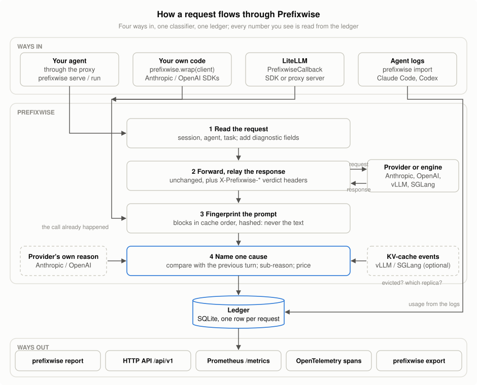
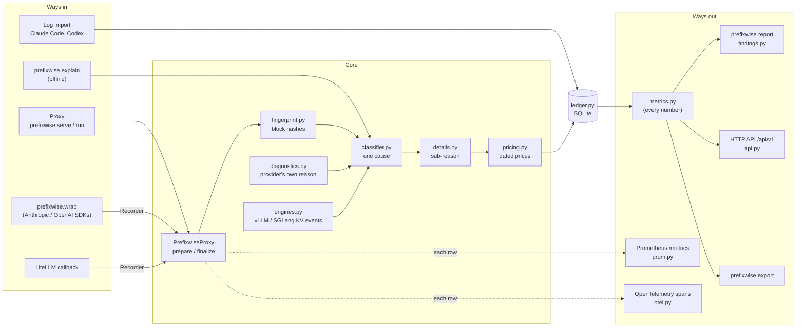
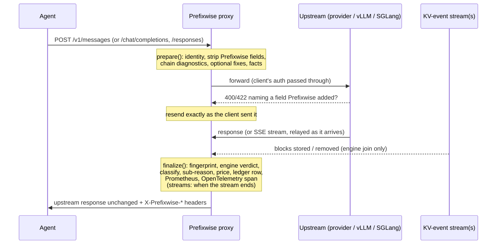
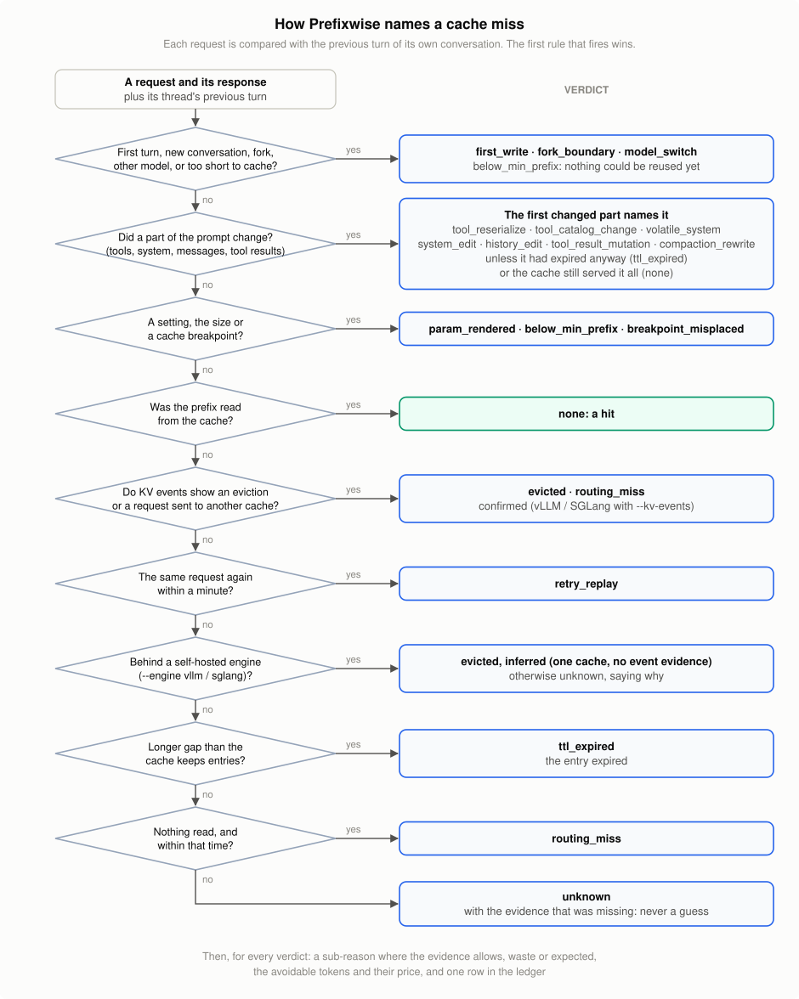

# Prefixwise architecture

How Prefixwise is built today (0.6, November 2026): the parts, how a request flows through
them, where data lives, and the rules every part keeps. For why it was designed this way, the
original research is in [DESIGN.md](DESIGN.md) (kept as written); the detailed designs are
[DATA.md](DATA.md) (data and metrics), [API.md](API.md), [ENGINES.md](ENGINES.md) (vLLM and
SGLang), [opentelemetry.md](opentelemetry.md) and [prometheus.md](prometheus.md).

## What it does, in one paragraph

Every LLM request an agent sends either reuses the provider's prompt cache or pays to recompute
its prefix. Prefixwise looks at each request and its response, names the **one** reason the
cache missed (19 causes, plus a sub-reason where the evidence allows), says whether that miss
was waste or expected, prices it, and records it in a local SQLite ledger. Everything people
see (`prefixwise report`, the HTTP API, Prometheus, OpenTelemetry) is computed from that ledger.
It stores hashes and counts, never prompt text.

## The shape of it

<picture>
  <source media="(prefers-color-scheme: dark)" srcset="figures/architecture-dark.svg">
  
</picture>

The chart shows the four live ways in; a fifth, `prefixwise explain`, runs the same classifier offline on
saved requests. The same, with every module named, as a Mermaid diagram:

- **The proxy** (`proxy.py`, stdlib only) is the reference path: an OpenAI- and
  Anthropic-compatible HTTP server that forwards to the real provider (or a vLLM / SGLang
  server) and sees the exact bytes sent and received.
- **`prefixwise.wrap` and the LiteLLM callback** do not forward anything: the call already
  happened. They hand the request and response to `sdk.Recorder`, which runs the proxy's own
  `prepare` / `finalize` in mock mode with no fixes, so they classify exactly as the proxy does.
- **Log import** (`importers.py`) reads Claude Code and Codex session logs for subscribers a
  proxy cannot reach. Logs have usage but no prompts, so it names only what the log shows
  changed (model, compaction, upgrade, a changed system prompt, effort, expiry) and leaves the
  rest `unknown`. It writes the same ledger rows, to its own ledger file.
- **`prefixwise explain`** (`explain.py`) runs the fingerprinting and classifier on saved
  request bodies, with no proxy and no API key.

## A request through the proxy

1. **`prepare`** reads identity (session, agent and task from `X-Prefixwise-*` headers or body
   fields, which are stripped before forwarding), then builds the body to forward:
   - it chains the provider's own diagnostics (Anthropic `diagnostics`, OpenAI
     `prompt_cache_options.comparison_response_id`) so the provider's miss reason is recorded
     beside Prefixwise's;
   - with `--engine` and `--kv-events`, it adds `session_id` and `vllm_xargs` so the engine
     tags its KV events with the session;
   - with an opt-in fix (`--fix canonical_tools`), it rewrites the request in a way that cannot
     change its meaning.

   Every added field is tracked (`ctx["injected"]`) and is the only change made. `prepare` also
   computes the request's facts for sub-reasons and registers it as in flight for its prefix.
2. **Forward.** If the upstream answers 400/422 naming a field Prefixwise added, the request is
   sent again exactly as the client sent it; after a second rejection that field is no longer
   added for that provider (`_undo_rejected`). Prefixwise never turns a working request into
   an error.
3. **`finalize`** runs when the response is complete (under one lock, so each turn is compared
   with the turn recorded just before it):
   - **fingerprint** the request as the provider received it into blocks in prefix order,
     three hashes each (`raw`, `canonical`, `masked`);
   - take the **engine verdict** from the KV events, if any;
   - build a **snapshot** and **classify** it against the previous snapshot of the same lane
     (session, model);
   - add a **sub-reason**, **price** the request and its avoidable part, write the **ledger
     row**, and export it to **Prometheus** and **OpenTelemetry**.

   If any of this fails, `finalize_safely` lets the response through and leaves a
   `not_recorded` row: the client already paid for that response.
4. **The response goes back unchanged**, with the verdict in `X-Prefixwise-Request-Id`,
   `-Cause`, `-Legit` and `-Avoidable-Tokens` headers. A stream is relayed as it arrives, so its
   verdict is recorded when it ends and served at `GET /requests/<id>`.

## Parts

| module | job |
|---|---|
| `proxy.py` | HTTP server, request lifecycle, per-session state (bounded: `PREFIXWISE_MAX_SESSIONS`, default 10,000), upstream forwarding, streaming relay, routes (`/v1/*`, `/tasks`, `/requests/<id>`, `/ledger`, `/engine`, `/health`, `/metrics`, `/api/v1`) |
| `fingerprint.py` | splits a request into blocks in the provider's prefix order; `raw` (exact bytes), `canonical` (sorted keys, NFC, fixed separators) and `masked` (dates, ids, numbers masked) hashes; HMAC for short, guessable blocks |
| `classifier.py` | `RequestSnapshot` → one `MissCause`, `legit` (waste or expected), evidence text, secondary causes |
| `details.py` | sub-reasons (`ttl_shortened`, `lookback_exceeded`, `markers_ignored`, `sent_before_cache_written`, `shared_prefix_not_reused`, `thinking_stripped`, `cache_key_changed`), each with strict preconditions |
| `diagnostics.py` | maps Anthropic's 6 and OpenAI's 9 native miss reasons onto the taxonomy; scores agreement (provider "no verdict" answers are not scored) |
| `engines.py` | the engine join: `EngineEvents` (one vLLM cache), `SGLangEvents` (SGLang), `EngineFleet` (several caches: vLLM ranks or replicas, SGLang ranks) |
| `fixes.py` | opt-in, meaning-preserving rewrites (`canonical_tools`) and the fix advice per cause |
| `pricing.py` + `prices.json` | dated price table (provider pages, with source and date); unknown rate means no dollar figure, never an invented one |
| `ledger.py` | SQLite (schema 5): `entries` (one row per request) and `tasks` (outcomes); migrates in place |
| `metrics.py` | every metric defined once; the CLI, API and export all call `query` |
| `findings.py` | the plain-English report: what the cache did, what the waste cost, the fix for each cause |
| `api.py` | `/api/v1`: summary, breakdowns, request rows, fixes, prices, explain |
| `prom.py`, `otel.py` | Prometheus exposition with bounded labels; OpenTelemetry GenAI spans with `prefixwise.cache.*` |
| `sdk.py` | `Recorder`, `wrap`, `session` |
| `litellm_callback.py` | `PrefixwiseCallback`: classifies the body LiteLLM actually sent |
| `importers.py` | Claude Code and Codex log import |
| `cli.py` | `serve`, `run`, `report`, `import`, `explain`, `export`, `task`, `fixes`, `prices`, `prune`, `request` |

## How a cause is decided

<picture>
  <source media="(prefers-color-scheme: dark)" srcset="figures/decision-dark.svg">
  
</picture>

The classifier (`classify(prev, curr)`) compares a request with **the previous turn of its own
conversation**: the same session and model (a lane, so a side call to a small model never masks a
cause on the main thread), and the same thread within it. A thread is known by its opening
message; the proxy remembers each conversation's latest turn (up to `PREFIXWISE_LANE_THREADS`,
default 8, per lane; one conversation costs one snapshot, as before), so parallel subagents
interleaving in one session are each compared with their own last turn, however long the others
ran in between, and the provider's diagnostics are chained to that same turn (a Responses turn
sent with `previous_response_id` belongs to its parent's conversation and is compared with the turn
it names). Known limits: conversations that open with the identical message are treated as one,
and past 8 conversations in a lane the least recently used one is forgotten. The
first rule that fires wins; later ones are kept as secondary causes. In order:

1. **No previous turn:** `first_write` (or `fork_boundary` for a forked session's first turn).
   **Another model:** `model_switch`. **A new conversation in the session** (its opening message
   matches none of the remembered conversations and its system prompt differs beyond dates and
   ids: a subagent of another type): `first_write`, or `none` if the cache served most of it. **The previous turn was too short to cache at all:** `below_min_prefix`, whatever
   else changed. All expected, not waste.
2. **The first part of the prompt that changed**, in the provider's prefix order (Anthropic and
   OpenAI: tools, system, messages, tool results; a self-hosted engine's template: system first),
   compared by block hashes, not text:
   - tools: `tool_reserialize` if the same tools were re-serialized (canonical equal, raw
     different), else `tool_catalog_change`;
   - system: `volatile_system` if only a date, time or id changed (masked hashes equal), else
     `system_edit`;
   - messages: `history_edit`, or `compaction_rewrite` when the client signalled a compaction;
   - tool results: `tool_result_mutation`, or `compaction_rewrite` after a compaction.

   Two facts from the response overrule a change: nothing was read and the gap exceeded the
   cache's TTL (the entry had expired anyway: `ttl_expired`), or the cache still served all of the
   prefix the previous turn could share (the change cost nothing: `none`). The change is kept as a
   secondary cause either way. A change that broke reuse part-way is priced for the part it cost:
   the reusable prefix minus what was read, never the whole prompt.
3. **Prompt unchanged:** `param_rendered` (a parameter that renders into the prompt changed),
   `below_min_prefix`, `breakpoint_misplaced` (Anthropic with no breakpoint, or one after
   volatile content).
4. **Nothing changed in the request**, judged from usage (absent usage is `unknown`, never a
   zero read as evidence):
   - a **hit**, `none`: at least half of the reusable prefix was read from cache;
   - engine evidence: a confirmed `evicted`, or a confirmed `routing_miss` across caches;
   - `retry_replay`: the identical request again within a minute, nothing cached;
   - with one self-hosted engine and no event evidence: `evicted`, inferred and said so (with
     several caches known, `unknown` instead);
   - `ttl_expired` when the gap exceeds the cache's TTL, `routing_miss` when nothing was read
     within it. The gap runs from the previous turn's response to this request's send: this
     request's own generation time is not idle time;
   - otherwise `unknown`, with the evidence that was missing. Prefixwise never guesses.

Then `details.py` may add a sub-reason, and may refine a cause where a precondition proves it
(for example `ttl_shortened`: 1 hour was asked, Anthropic kept the write 5 minutes, so the miss
is `ttl_expired`). The provider's own reason, when it gives one, is recorded beside the cause
and scored for agreement, but never overrides it.

`legit` is separate from the cause: a first request or a model switch costs tokens but is not
waste; `avoidable_tokens` and `avoidable_cost` count only waste.

## The engine join (self-hosted vLLM and SGLang)

Hosted providers say what they read from cache; they never say *why* they did not. Behind a
self-hosted engine Prefixwise can find out, from the engine's KV-cache events (ZMQ). Full
design and limits: [ENGINES.md](ENGINES.md).

- **One cache** (`EngineEvents` for vLLM, `SGLangEvents` for SGLang): Prefixwise sends its
  session id; the engine tags the blocks it stores with it. At the response, the block where
  the cache read stopped decides: removed means a **confirmed eviction**; still on the GPU
  means the token prefix changed although the request did not. "Not an eviction" is claimed
  only when nothing can make it wrong (stream caught up, no lost messages, full attention only,
  one request of the session in flight).
- **Several caches** (`EngineFleet`: vLLM data-parallel ranks or replicas behind a router, SGLang
  data-parallel ranks): the
  cache that served a request is the one whose stream reported the session's blocks after the
  send, so the router need not say. A turn served by another cache, while the previous one
  still holds the very block this turn needed, is a **confirmed routing miss**. A replica that
  disconnects is forgotten; nothing is claimed across the gap.
- **Offload tiers** (LMCache, SGLang HiCache): a prefix restored from CPU memory counts as a
  hit, so only prefixes lost from every tier are evictions.

## Data

- **The ledger** is the single store: one `entries` row per request (identity, cause, detail,
  legit, tokens split into uncached / cache read / cache write, cost, latency, Prefixwise's own
  overhead, evidence, provider reason, status and error for failed requests) and one `tasks`
  row per task outcome, for **tokens per successful task**. Failed requests are rows too, so
  error rates exist and every rate has an honest denominator. Old rows are removed with
  `prefixwise prune`.
- **`metrics.py`** defines each number once. `report`, `/api/v1`, `export` and the findings all
  read through it, so the same question gives the same answer everywhere.
- **Live telemetry** is written per row as it is recorded: Prometheus counters and histograms
  (labels bounded to provider, model, cause and error; no session ids) and, when enabled, an
  OpenTelemetry span. Inside an application, spans go to its tracer provider; Prefixwise
  installs one only as its own process (`serve`, `run`).

## Rules every part keeps

- **Never a guess.** A cause, a sub-reason or an engine verdict is claimed only when its
  evidence holds; otherwise `unknown` or no detail, with the reason. Every false claim a review
  found became a test that must produce no claim.
- **Fail open.** Recording, classifying, exporting or telemetry can never break, delay beyond
  its bound, or change a request. Errors are reported once and the call goes through.
- **The client's request is the client's.** Prefixwise adds only tracked diagnostic fields and
  removes them if an upstream refuses them; rewrites happen only with an explicit opt-in fix.
  It never changes routing (it sends no session-affinity header).
- **No prompt text.** Hashes (HMAC for short blocks), counts and Prefixwise's own words.
- **Bounded memory.** Per-session state, block indexes and in-flight checks all have caps.
- **Stdlib core.** The proxy, classifier and ledger need only Python 3.10+. Extras are opt-in:
  `[engines]` (pyzmq, msgspec), `[otel]` (OpenTelemetry SDK and OTLP exporter); the SDK
  wrappers and the LiteLLM callback use whatever SDK the application already has.

## Extending it

- **Any change to the flow or the rule order:** redraw the flowcharts
  (`python docs/figures/make_architecture.py`); `tests/test_figures.py` fails until the committed
  SVGs match the script and the decision chart names every cause.
- **A provider or API shape:** block extraction in `fingerprint.py` (prefix order), usage
  normalization and diagnostics in `proxy.py` / `diagnostics.py`, prices in `prices.json` with
  source and date.
- **A cause or sub-reason:** a rule in `classifier.py` or `details.py`, with its preconditions
  stated, and tests for the scenarios that must *not* produce it.
- **An integration:** call `sdk.Recorder.record(provider, request, response, ...)` with the
  request as sent and the response as received; it never raises.
- **An engine:** an events class with `request_sent` / `request_done` / `discard` (see
  `EngineEvents`), and a startup check of what the engine reports about itself.

## How it is checked

- **Tests** (`tests/`, about 315): every cause and sub-reason, every no-claim case found in
  review, the real OpenAI, Anthropic and LiteLLM clients against the mock server, KV events
  over real ZMQ sockets with each engine's own wire structs, OpenTelemetry against an in-memory
  exporter and an end-to-end OTLP collector. CI runs them on Python 3.10 to 3.13, plus a Docker
  build.
- **Live experiments** (`experiments/`, each with a dated run record): agreement with
  Anthropic's and OpenAI's own miss reasons, evictions on vLLM and SGLang (confirmed 5/5 from
  KV events), LMCache and HiCache restores (5/5 hits), routing misses across two vLLM replicas
  (confirmed 5/5), Claude Code and Codex log import on real logs.
- **Reviews:** every feature is reviewed independently against the source it plugs into before
  it merges; findings are fixed and become tests.
